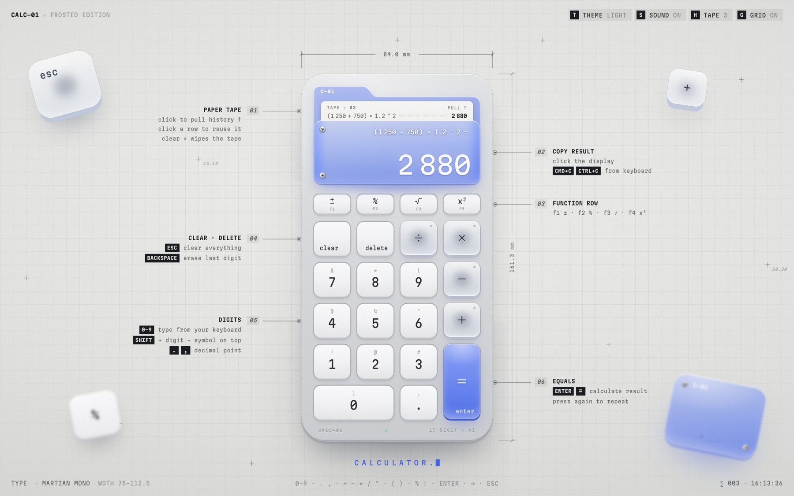
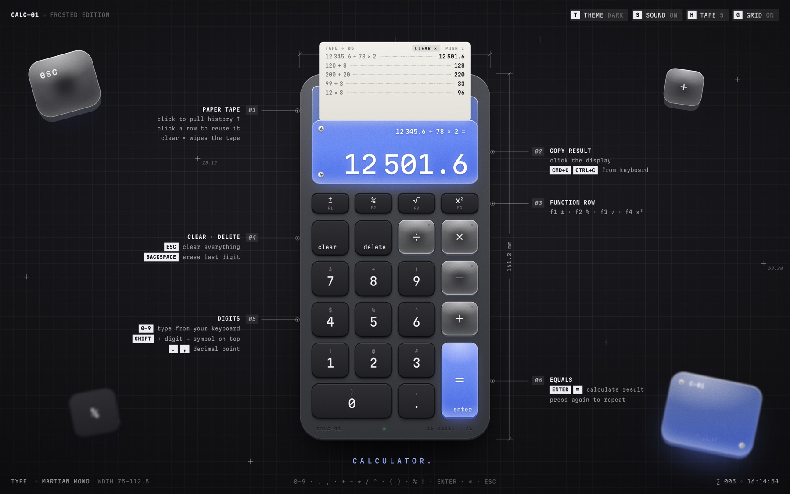
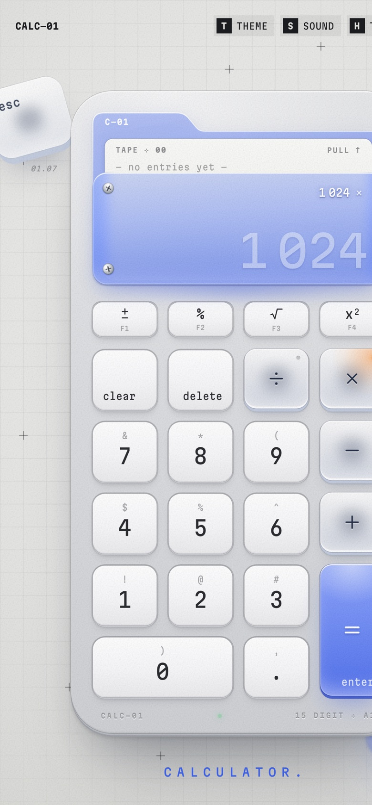
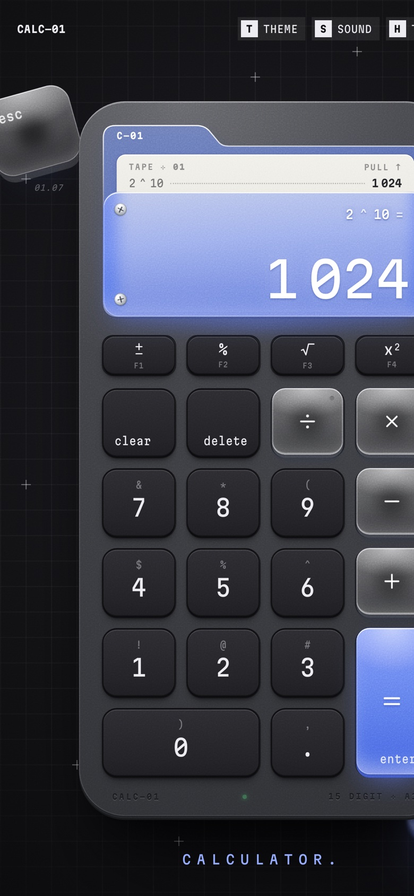

# ✦ Calc—01

A calculator in a single HTML file: keys styled after the Apple Magic Keyboard, frosted glass operators, an acrylic "folder" display held by screws, and a paper tape that keeps your history. ⋆｡°✩

**⊹ Open it:** [Calc—01](https://vvallll.github.io/calc-01/)

### ⊹ Features

- ✦ Order of operations and brackets (nested; unclosed ones close themselves), power `^`, factorial `!`, percent, `√`, `x²`, `±`.
- ✦ Pressing `=` again repeats the last step: `2 + 3 = 5`, then `8`, `11`…
- ✦ History on a paper tape: pull it out, scroll through it, tap a row to reuse its result. The `clear ×` button wipes the tape.
- ✦ Click the display to copy the number.
- ✦ Light and dark themes, key sounds, works on phones.
- ✦ Add it to your phone's home screen: it gets its own icon and opens full screen, like an app.

### ✧ Screens

Dark theme, with the paper tape pulled out:

On a phone: a pending `×` lights its orange LED, and `2 ^ 10 = 1 024` in the dark theme.

  
  &nbsp;&nbsp;
  

### ⌨ Keyboard

| Keys | Action |
|---|---|
| `0–9`, `.` or `,` | enter a number |
| `+` `−` `*` `/` | operators |
| `Shift` + `1` `5` `6` `8` `9` `0` | `!` `%` `^` `*` `(` `)` |
| `Enter` or `=` | calculate |
| `Backspace` | erase the last digit |
| `Esc` | clear everything |
| `F1`–`F4` | `±` `%` `√` `x²` |
| `Cmd`/`Ctrl` + `C` | copy the result |
| `T` `S` `H` `G` | theme, sound, tape, grid |

On a phone, long-press a key to enter the symbol printed above its digit.

### ⊹ How it's built

One `index.html` file with no build step and no dependencies; the Martian Mono typeface loads from Google Fonts. To run it locally, just open the file in a browser.

- ✦ `index.html` · the whole calculator
- ✦ `favicon.svg`, `favicon.ico` · the tab icon, a blue acrylic `=` key
- ✦ `apple-touch-icon.png`, `icons/` · home screen icons for iPhone and Android
- ✦ `site.webmanifest` · name, icons and colours when it's installed
- ✦ `og-image.jpg` · the picture shown when you share the link
- ✦ `screenshots/` · the pictures in this README

### ♡ A little calculator

`one file → no dependencies → a few calculations → a little bit of magic` ⊹
